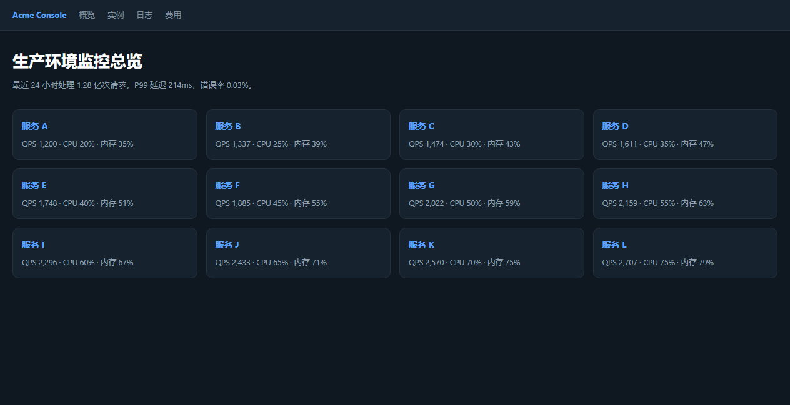
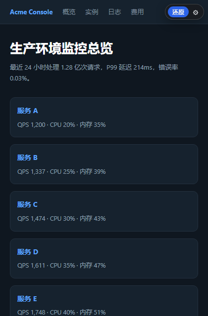
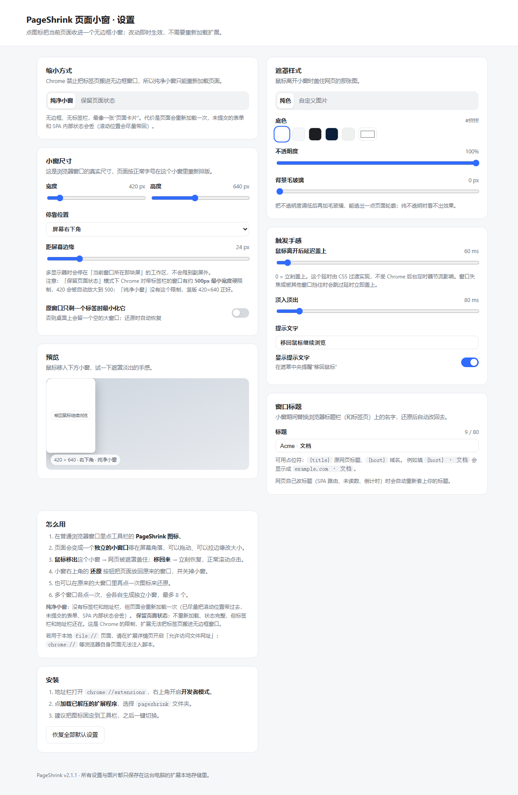

# PageShrink 页面小窗

点一下工具栏图标，把当前页面收进一个独立的小窗口。**鼠标移出小窗，网页就被一张干净的图盖住；鼠标移回来，立刻恢复。**

一个专注（或者说"摸鱼"）向的小工具：页面还在，但屏幕上只剩一张白色或你自己指定的图片。

| 普通页面 | 鼠标在小窗内 → 网页可见可操作 | 鼠标移出小窗 → 被遮罩盖住 |
| --- | --- | --- |
|  |  |  |

## 安装

### 从源码加载（当前唯一方式）

1. 克隆或下载本仓库
2. 打开 `chrome://extensions`，开启右上角的**开发者模式**
3. 点**加载已解压的扩展程序**，选择仓库根目录（该目录下能直接看到 `manifest.json`）
4. 建议把图标固定到工具栏

> 商店版本正在提交中，上架后这里会换成安装链接。

### 用于本地文件

如果要在 `file://` 页面上使用，需要在扩展详情页开启「允许访问文件网址」。`chrome://` 等浏览器自身页面出于安全策略无法注入脚本。

## 使用

| 操作 | 结果 |
| --- | --- |
| 点工具栏图标 | 当前页面进入小窗模式 |
| 鼠标**移出**小窗 | 网页被遮罩盖住（默认纯白，可换自定义图片） |
| 鼠标**移回**小窗 | 遮罩淡出，网页恢复可见、可滚动、可点击 |
| 点小窗右上角「还原」 | 回到普通窗口 |
| 在原窗口再点一次图标 | 同样还原 |

支持同时开多个小窗（每个源窗口一个，上限 8 个），工具栏徽章显示当前数量。

## 两种缩小模式

| | 纯净小窗（默认） | 保留页面状态 |
| --- | --- | --- |
| 外观 | 无标签栏、无地址栏 | 浏览器 UI 都在 |
| 页面是否重新加载 | **会** | 不会，状态完整保留 |
| 未提交的表单 / SPA 内部状态 | 丢失（滚动位置会尽量带回） | 保留 |
| 最小宽度 | 无限制 | Chrome 有约 500px 硬限制 |

为什么必须二选一：Chrome 明确禁止把标签页搬进 `type:'popup'` 窗口（`chrome.tabs.move` 会报 `Tabs can only be moved to and from normal windows`）。所以无边框小窗只能重新加载同一个 URL。

## 设置

点扩展的「详情 → 扩展程序」，或小窗工具条上的 ⚙：

- **小窗尺寸 / 停靠位置 / 边距** —— 停靠位置支持四角和居中，多显示器下会停在当前窗口所在那块屏
- **遮罩样式** —— 纯色或上传自定义图片（支持 cover / contain / stretch / repeat / center），可调不透明度和背景毛玻璃
- **触发手感** —— 离开后延迟盖上（默认 60ms，0 = 立刻）、淡入淡出时长
- **窗口标题** —— 小窗期间替换浏览器标题，支持 `{title}`、`{host}` 占位符，留空则不改
- **提示文字** —— 遮罩中央的提醒气泡

所有设置存在 `chrome.storage.local`，改动即时生效，不用重新加载扩展。



## 权限说明

| 权限 | 用途 |
| --- | --- |
| `storage` | 保存遮罩样式、自定义图片、尺寸等设置；以及跨 service worker 重启保存小窗会话表（`storage.session`）。**数据全部留在本机，无任何网络回传。** |
| `activeTab` | 点击图标时获取当前标签页信息，用于判断该页能否缩小 |
| `scripting` | 扩展刚安装或刚重载时，页面上的内容脚本已失效，用它在点图标那一刻补注入一次 |
| 内容脚本匹配 `http/https/file` | 遮罩需要在任意页面上工作，因此需要静态注入 |

没有使用任何远程代码、外部 CDN、`eval`。

## 隐私

- 不收集、不上传、不分享任何数据，没有服务器，没有统计代码
- 自定义遮罩图片以 base64 存在本机扩展存储里
- 不读取浏览历史、Cookie、表单内容
- 不修改页面请求或网络流量

## 实现要点

几个不太直观、但踩过坑的决定，记在这里：

**遮罩用 `<canvas>` 画，而不是 CSS `background-image`。** 很多站点有严格的 CSP `img-src`，会把扩展注入样式里的 `url(data:...)` 静默拦掉，表现为"设置没生效"。改成把 dataURL 手工解 base64 → Blob → `createImageBitmap` → 绘制，完全绕开 CSP，顺带免费拿到 cover / contain / repeat 这些填充模式。

**遮罩的"延时"交给 CSS `transition-delay`，不用 `setTimeout`。** 两个原因：窗口失焦时 Chrome 会节流该渲染器的定时器（实测 250ms 的 timer 能拖到 780ms）；页面主线程繁忙时 JS 定时器同样会被推迟。`transition` 由合成器驱动，不受这两者影响。同时把 `var()` 写在 `transition-duration` / `transition-delay` 这些 longhand 上而不是 `transition` 简写里——简写里的变量值一旦不合法，整条声明会静默失效。

**改窗口标题要用 `MutationObserver` 顶住 SPA。** 页面自己会改 `document.title`（路由、未读数、倒计时）。防自己触发自己**不能用同步 flag**——`MutationObserver` 回调是微任务，等它跑的时候同步 flag 早复位了。改成比对"最后一次我们写入的值"，只有当前标题和它不一致才认定是页面改的。

**调整窗口尺寸后必须重算位置。** `chrome.windows.create` 的 `width/height` 是窗口**外框**，标题栏会吃掉约 95px 内容高度，所以要做一次补偿 resize。但补偿时如果只改尺寸不改 `left/top`，右下停靠的窗口会朝屏幕外长出去。

**不用 `chrome.system.display`。** 在没有显示信息的环境里（headless、部分远程桌面）调用 `getInfo()` 会**直接终止 service worker 进程**，不是抛异常。屏幕可用区改由页面回报 `screen.avail*` 获取，零权限且天然支持多显示器。

## 开发

```
.
├── manifest.json      MV3 清单
├── background.js      service worker：窗口编排 + 会话表
├── content.js         内容脚本：遮罩、悬停检测、标题替换
├── options.html/js    设置页
├── icons/
├── scripts/           打包、生成截图（开发期工具，不进扩展包）
└── tests/             端到端回归测试
```

扩展本体是纯手写 JS，**没有构建步骤**——克隆下来就能直接「加载已解压的扩展程序」。根目录的 `package.json` 只服务于测试和打包脚本。

### 跑测试

```bash
npm install
# 必须用 Chromium 或 Chrome for Testing：
# 品牌版 Google Chrome 从 137 起会忽略 --load-extension，扩展根本装不进去
set CHROME_PATH=C:\path\to\chrome.exe     # Windows
npm test                                   # 全部；也可 npm run test:v2 / :title / :ui / :size
```

四个测试脚本合计 106 项断言：小窗创建与还原、视口真实缩小、遮罩像素级校验、鼠标进出触发、拖拽移动、连续开关无泄漏、设置页真实鼠标点击、窗口标题替换与 SPA 对抗、五个停靠位置不出屏。

> 测试必须在**有头模式**下跑：headless 里所有窗口共享同一块渲染表面，per-window 尺寸不生效，"页面是否真的按小视口重排"根本测不出来。同时 `puppeteer.launch` 要传 `defaultViewport: null`，否则 puppeteer 会给每个页面强加 800×600 的模拟视口，`innerWidth` 是假的。

### 打包

```bash
node scripts/pack.js     # -> dist/pageshrink-<version>.zip
```

生成的是 Chrome Web Store 提交格式（`manifest.json` 在 zip **根目录**）。把整个文件夹压进去是"加载已解压的扩展程序"的分享格式，商店上传会直接报错。

### 重新生成 README 截图

```bash
node scripts/screenshots.js
```

## 已知限制

- 页面若把滚动做在 `window` 上并监听 `window.onscroll`（部分无限滚动站点），小窗内滚动不会触发这些监听
- 「纯净小窗」模式下页面会重新加载一次，未提交的表单内容会丢
- 遮罩只覆盖网页内容区，覆盖不到操作系统标题栏
- 扩展无法让窗口保持在最上层（Chrome 没有这个 API）
- 扩展重载后，已打开页面里的旧内容脚本会失效；此时点图标会自动补注入一次

## License

[MIT](LICENSE)
